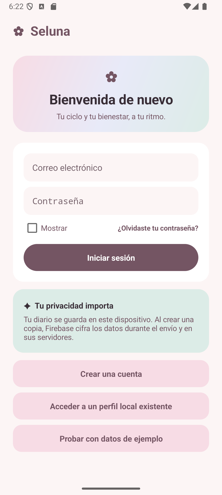
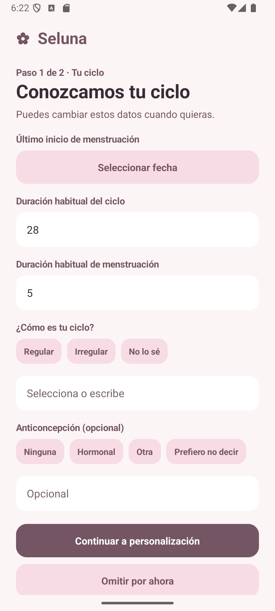
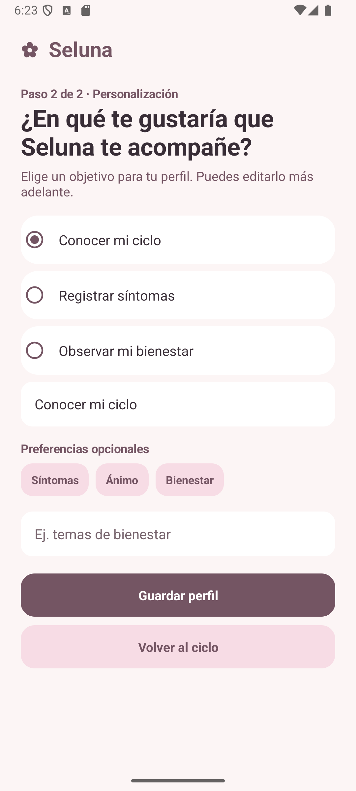
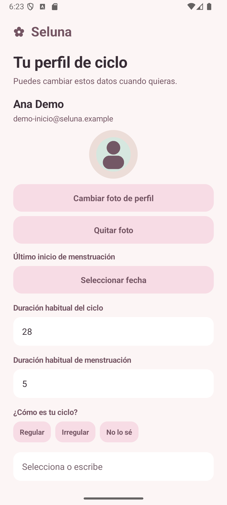
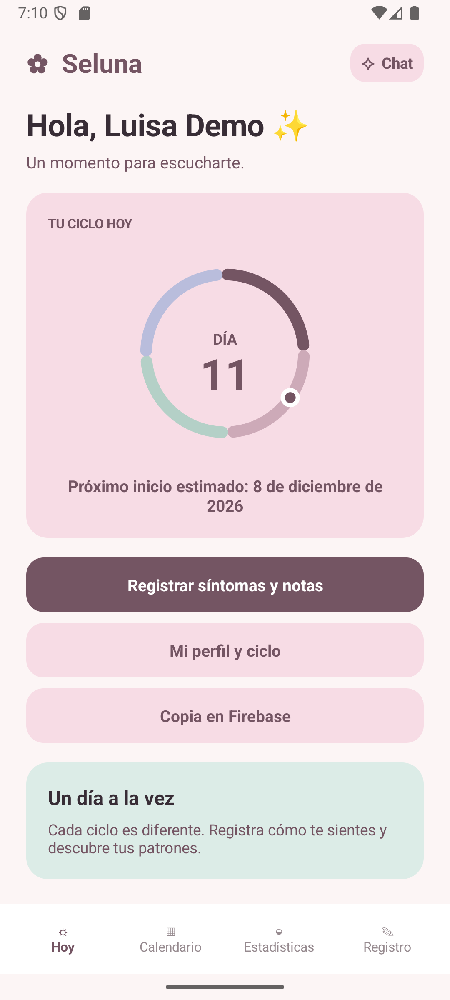
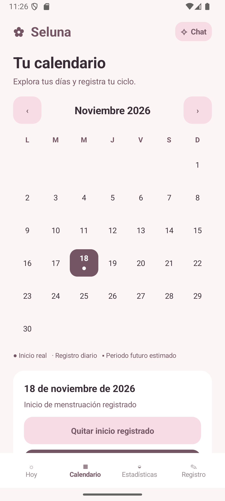
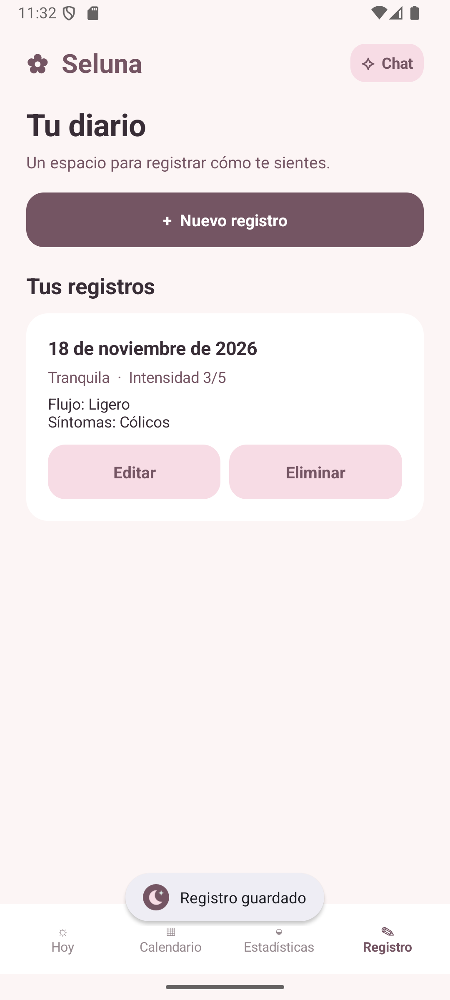
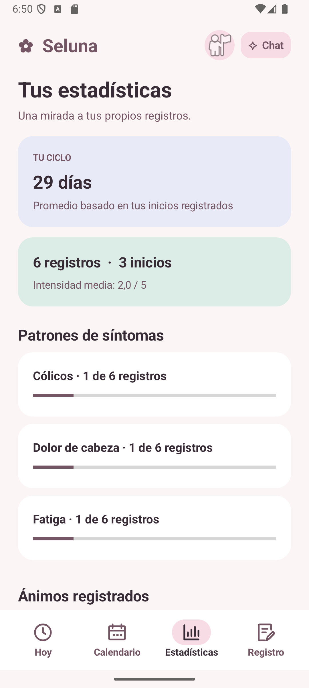
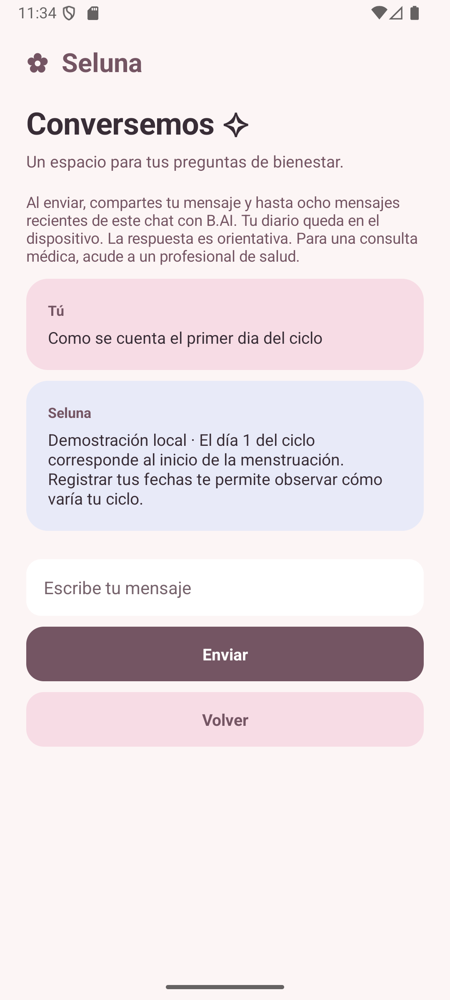

# Seluna

Beta Android de Tecnologías Móviles, desarrollada por **Luisa Fernanda Velandia Salamanca**. Incluye seguimiento de ciclo, calendario, registro diario, estadísticas de síntomas, exportación de resumen PDF y un asistente educativo opcional.

- [Entrega de clase y descargas](docs/entrega.md)
- [Plan y criterios de aceptación](docs/plan.md)
- [Diagrama de clases y datos](docs/modelo-datos.md)
- [Pruebas funcionales y evidencia de la rúbrica](docs/pruebas-funcionales.md)
- [Presentación con guion](docs/presentacion.html) · Usa `←` y `→` para avanzar o retroceder. `N` abre el guion debajo de la diapositiva y `Esc` lo cierra.
- [Mockups de Seluna en Figma](https://www.figma.com/design/NSu4CMDTwWvWka0ClNQGJ2/ProyectoMov?node-id=0-1&p=f)

## Capturas de la beta

Capturas del emulador Android con perfiles y registros ficticios. El chat muestra una respuesta de la guía sin conexión.

| Acceso | Configuración del ciclo | Personalización | Perfil |
| --- | --- | --- | --- |
|  |  |  |  |

[Formulario para crear cuenta](docs/capturas/registro-cuenta.png)

| Hoy | Calendario | Registro | Estadísticas | Asistente |
| --- | --- | --- | --- | --- |
|  |  |  |  |  |

[Tarjeta editorial de bienestar](docs/capturas/bienestar.png) · [Vista del informe de salud](docs/capturas/informe.png)

## Ejecutar en Android Studio

El instalador para clase se entrega como `entrega/Seluna-Entrega.apk`. Usa la variante `release` y está firmado con el certificado de pruebas Android para instalarlo o actualizar la beta de clase que use ese mismo certificado. Para distribuir en Google Play se usa la firma de publicación de Seluna. La carpeta `entrega` se conserva fuera de Git.

Abre esta carpeta como proyecto, usa JDK 17 y Android SDK 35, selecciona la variante `debug` y ejecuta en un teléfono o emulador con Android 8.0 o superior. Desde PowerShell también puedes compilar y ejecutar el análisis estático.

```powershell
.\gradlew.bat :app:assembleDebug :app:lintDebug
```

El APK queda en `app/build/outputs/apk/debug/app-debug.apk`. El acceso principal usa Firebase Authentication. El diario sigue disponible en el dispositivo durante una sesión iniciada. Para la demostración del asistente, usa el emulador Android estándar. El APK de depuración apunta a `10.0.2.2:8787`, la dirección con la que el emulador llega al equipo anfitrión.

En la APK de depuración, **Probar con datos de ejemplo** abre uno de estos perfiles locales. También puedes usar el correo correspondiente y la contraseña `SelunaDemo26!` en **Iniciar sesión**. El seeder carga los ejemplos la primera vez y conserva las ediciones posteriores.

| Perfil ficticio | Correo local | Datos iniciales |
| --- | --- | --- |
| Seguimiento de ciclo | `demo@seluna.example` | Tres inicios y seis registros ficticios. |
| Ciclos variables y síntomas | `demo-sintomas@seluna.example` | Intervalos irregulares y seis registros ficticios. |
| Primer uso sin historial | `demo-inicio@seluna.example` | Onboarding y diario vacío. |

La APK **release** usa las cuentas de Firebase de `seluna-app`. Puedes crear una desde **Crear una cuenta** o iniciar sesión con un correo y contraseña ya registrados en ese proyecto. El mismo acceso funciona en la beta y en la versión final con Firebase configurado. Los perfiles del seeder se incluyen en la compilación de depuración. [Acceso con contraseña](https://firebase.google.com/docs/auth/android/password-auth) · [Firma Android](https://developer.android.com/studio/publish/app-signing)

## Registro de Firebase

Para preparar la integración con Firebase, registra una app Android en el proyecto de tu cuenta.

| Campo | Valor |
| --- | --- |
| Nombre del proyecto | `Seluna` |
| Nombre del paquete Android | `com.seluna.app` |
| Alias de la app | `Seluna` |
| SHA‑1 | Puedes dejarlo en blanco para correo y contraseña. Añádelo si vas a habilitar Google como proveedor. |

Habilita **Authentication → Correo electrónico/contraseña** y usa **Cloud Firestore en modo producción**. Descarga `google-services.json` desde la configuración de la app Android y colócalo en `app/google-services.json`. Gradle aplica el complemento Google Services cuando encuentra ese archivo. Las reglas del repositorio permiten leer y escribir el perfil y la copia al titular del UID. [Configuración de Android](https://firebase.google.com/docs/android/setup) · [Acceso con contraseña](https://firebase.google.com/docs/auth/android/password-auth) · [Reglas de Firestore](https://firebase.google.com/docs/firestore/security/rules-conditions)

En **Crear una cuenta**, escribe tu nombre, correo y contraseña. El nombre que ingresas se guarda en el perfil local y como nombre visible de Firebase Authentication. El correo sirve para iniciar sesión y recuperar el acceso. Firebase asigna el UID al crear la cuenta.

| En la consola de `seluna-app` | Qué puedes verificar |
| --- | --- |
| **Authentication → Usuarios** | El correo y el UID de la cuenta. Firebase Authentication también administra el nombre visible. |
| **Firestore Database → Datos → `users/{uid}`** | El perfil con el `displayName` que escribió la titular y la fecha `updatedAt`. Se crea aparte de la copia del diario. |
| **Firestore Database → Datos → `users/{uid}/backups/current`** | El respaldo de ciclo, inicios y diario, cuando la titular lo guarda manualmente o activa la copia automática. |

Las reglas de perfil ya están publicadas en `seluna-app`. Las cuentas existentes con nombre en Authentication pueden completar el documento al volver a abrir la app actual con conexión. Si todavía ves un documento padre vacío, comprueba el UID en Authentication y si la app ya pudo guardar el perfil. La foto se conserva en el almacenamiento privado del equipo. [Administrar usuarios y actualizar el nombre visible](https://firebase.google.com/docs/auth/android/manage-users)

El APK de entrega creó una cuenta ficticia cuyo nombre aparece en Authentication y en el documento privado de Firestore. En esa prueba, la copia del diario aún estaba desactivada y Firestore rechazó una lectura anónima del perfil.

En **Hoy → Copia en Firebase → Activar copia automática**, confirma el envío de configuración, inicios y diario, incluidas las notas. Seluna guarda cada cambio en SQLite y respalda los cambios mientras la app está abierta y tiene conexión. Si el envío falla, el diario queda disponible en el equipo y la app reintenta durante el uso o al volver a abrirla. La copia aparece en **Firestore Database → Datos → `users/{uid}/backups/current`**.

En un dispositivo sin historial local, entra con la misma cuenta de Firebase. Seluna intenta recuperar su copia antes del onboarding. La activación de nuevas copias se elige por dispositivo. Si el móvil y Firebase tienen cambios distintos, la app conserva ambas versiones y pide revisar la copia. **Restaurar copia** añade datos ausentes. **Guardar copia en Firebase** reemplaza la copia tras confirmación. La foto sigue guardándose solo en el equipo.

En la prueba previa de `seluna-app`, Android guardó una copia con seis registros ficticios y tres inicios, recuperó un registro del diario y verificó que Firestore rechaza una lectura anónima. Las capturas de consola se tomaron durante esa prueba.

La prueba de respaldo automático guardó un registro ficticio en un emulador. Al entrar con la misma cuenta en un segundo emulador, el registro apareció en el diario sin pulsar **Restaurar copia**.

[Authentication en la prueba anterior](docs/capturas/firebase-auth.png) · [Copia en Firestore](docs/capturas/firebase-firestore.png) · [Reglas de esa prueba](docs/capturas/firebase-reglas.png)

Para administrar Firebase, abre una terminal nueva con `pwsh -NoProfile -NoExit -File .\scripts\Firebase-Seluna.ps1`. El acceso por código usa `entrega/firebase-luisa-cli`, separado de las sesiones habituales. Usa siempre `--project seluna-app` y la ruta al `firebase.json` del proyecto al desplegar reglas. Al terminar, ejecuta `pwsh -NoProfile -File .\scripts\Firebase-Seluna.ps1 -Cerrar` desde la raíz del proyecto para retirar la sesión temporal. [Referencia de Firebase CLI](https://firebase.google.com/docs/cli)

## Probar el asistente

Las preguntas reconocidas por la guía se contestan en Android sin conexión. Para probar una consulta fuera de la guía con una respuesta de demostración, inicia el servidor desde la raíz del proyecto con Node.js 22 o superior.

```powershell
node server/server.mjs --demo
```

Para usar el modelo real, detén el servidor de demostración, copia `server/.env.example` a `server/.env` si el archivo todavía no existe y escribe tu clave en `BAI_API_KEY`. Luego verifica el acceso al modelo e inicia el servidor.

```powershell
node server/server.mjs --check-model
node server/server.mjs
```

El servidor lee la clave exclusivamente de `server/.env`, excluido de Git, y usa `https://api.b.ai/v1` con el identificador `qwen3.8-flash`. Las consultas fuera de la guía se envían al modelo con un máximo de 240 tokens de salida. Se usa como referencia hasta una ficha breve de la guía y, en preguntas de seguimiento, hasta dos mensajes anteriores recortados. El perfil y el diario se conservan en SQLite. El servidor de referencia escucha solo en el equipo anfitrión. El chat con Qwen en un teléfono físico requiere desplegar un servicio HTTPS con control de acceso, que queda fuera de esta beta. [B.AI · Qwen3.8 Flash](https://docs.b.ai/llmservice/models/qwen3-8-flash/)

## Recorrido para exponer

1. En el APK de entrega, abre **Crear una cuenta** con un correo de prueba bajo tu control y muestra el onboarding. Puedes preparar la cuenta y un historial antes de exponer. En la compilación de depuración, **Probar con datos de ejemplo** permite mostrar el primer uso y un historial ficticio.
2. Muestra el anillo de Hoy y la fecha estimada. Abre el calendario y selecciona un día.
3. Guarda un registro con flujo, ánimo, síntomas e intensidad. En **Estadísticas → Exportar informe de salud en PDF**, selecciona el resumen o incluye la tabla diaria. El informe se genera en el dispositivo y excluye las notas personales.
4. Abre el chat y selecciona «¿Cómo se cuenta el día 1 del ciclo?» para probar la guía local. Para mostrar el servidor, escribe una pregunta diferente, como «¿Cómo puedo preparar preguntas para mi próxima consulta sobre mi ciclo?».

## Publicar desde una cuenta aislada

Desde una terminal del proyecto, ejecuta `.\scripts\Publicar-Seluna.ps1`. Abre el enlace de GitHub en una ventana de incógnito y autoriza el código temporal con `123LUISAV`. El script comprueba el usuario, verifica o crea `123LUISAV/seluna` como repositorio privado y confirma el commit de `main` después del push. Guarda la sesión en un directorio temporal propio y retira sus credenciales locales al finalizar. [GitHub CLI · Acceso por código](https://cli.github.com/manual/gh_auth_login)
