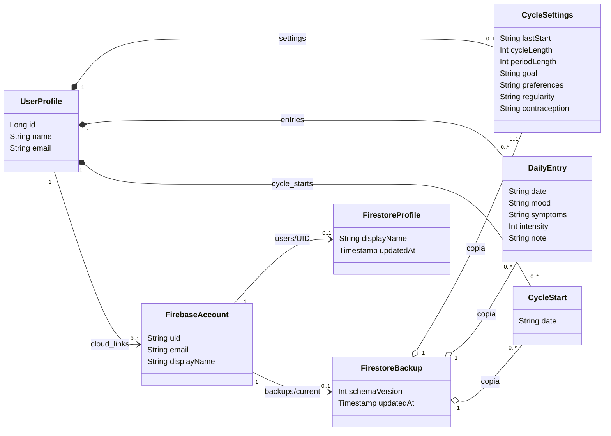

# Seluna · Diagrama de clases y persistencia

Luisa Fernanda Velandia Salamanca · U00179371 · Tecnologías Móviles

| Dónde | Qué guarda |
| --- | --- |
| SQLite · `users` | ID, nombre, correo, estado del onboarding y foto local opcional. Los perfiles locales antiguos y de demostración conservan sal y hash PBKDF2. Las cuentas nuevas de Firebase se abren por UID y no almacenan la contraseña en SQLite. |
| SQLite · `settings`, `entries`, `cycle_starts` | Configuración, diario e inicios vinculados a `user_id`. El diario y los inicios admiten una fila por perfil y fecha. `CycleStart` representa esas filas, como fechas en Kotlin. |
| SQLite · `cloud_links` | Par único de perfil local y UID de Firebase. Los datos de una cuenta permanecen separados de los de otras cuentas del dispositivo. |
| Firebase Authentication | Identidad con UID y correo. El nombre visible proviene del campo de nombre del formulario. |
| Cloud Firestore · `users/{uid}` | Perfil con el nombre visible y la fecha de actualización del servidor. El correo permanece en Authentication. El documento puede faltar en cuentas antiguas hasta que se guarde su perfil con la app actual. |
| Cloud Firestore · `users/{uid}/backups/current` | Copia de configuración, inicios y diario, con fecha de actualización. Puede guardarse al confirmar o automáticamente al activar la opción. La foto queda en el dispositivo. |

La app conserva por UID la última revisión confirmada y una huella del historial. Con el respaldo activado, comprueba la revisión antes de subir cambios. Si hubo cambios distintos en ambas versiones, conserva ambas y pide revisión. Un equipo sin datos solicita la copia de la cuenta al iniciar sesión.

Android aísla SQLite dentro del almacenamiento privado de la app. Firebase cifra las copias en tránsito y en reposo. Las reglas de Firestore limitan el acceso del cliente al UID de la titular, tanto para el perfil como para la copia. El cifrado de extremo a extremo y el cifrado propio de SQLite quedan fuera de esta beta. [Protección de Android](https://developer.android.com/privacy-and-security/security-tips) · [Privacidad de Firebase](https://firebase.google.com/support/privacy) · [Documentos padre en Firestore](https://firebase.google.com/docs/firestore/using-console)

Las capturas previas de la consola muestran [cuentas de prueba](capturas/firebase-auth.png), [una copia ficticia](capturas/firebase-firestore.png) y [las reglas de copia de esa prueba](capturas/firebase-reglas.png).
